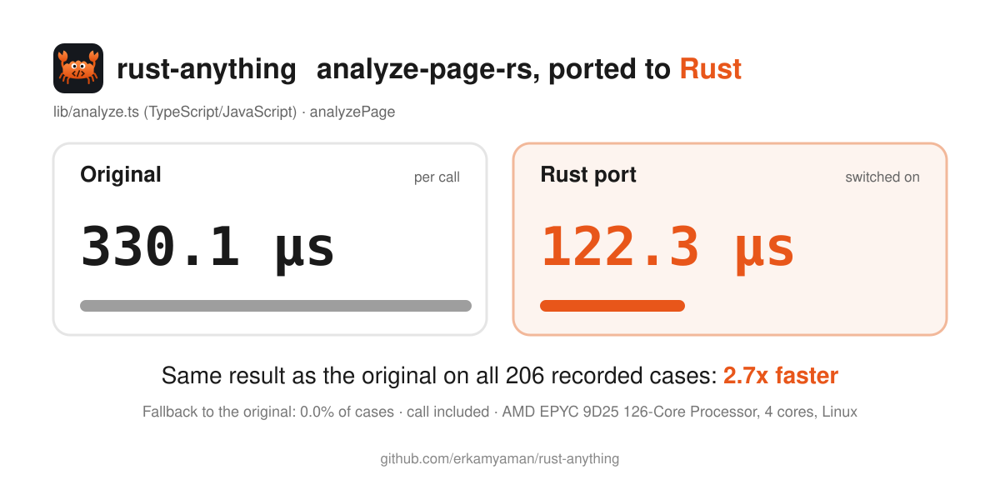

## `analyze-page-rs` in Rust

| | |
| --- | --- |
| Unit | `lib/analyze.ts` (TypeScript/JavaScript) |
| Recorded cases matched | 206 / 206 |
| Speedup, call included | 2.7x (geometric mean) |
| Fallback to the original | 0.0% (0 of 206 cases) |
| Switched on | on |

| Function | Cases | Original per call | Rust per call | Speedup |
| --- | ---: | ---: | ---: | ---: |
| `analyzePage` | 206 | 330.1 µs | 122.3 µs | 2.7x |

Measured with `rust-anything report` on AMD EPYC 9D25 126-Core Processor, 4 cores, Linux: `diff` replays every recorded case, `bench` times them on both sides as callers call them. Reproduce: `rust-anything diff` and `rust-anything bench` in the crate folder.
